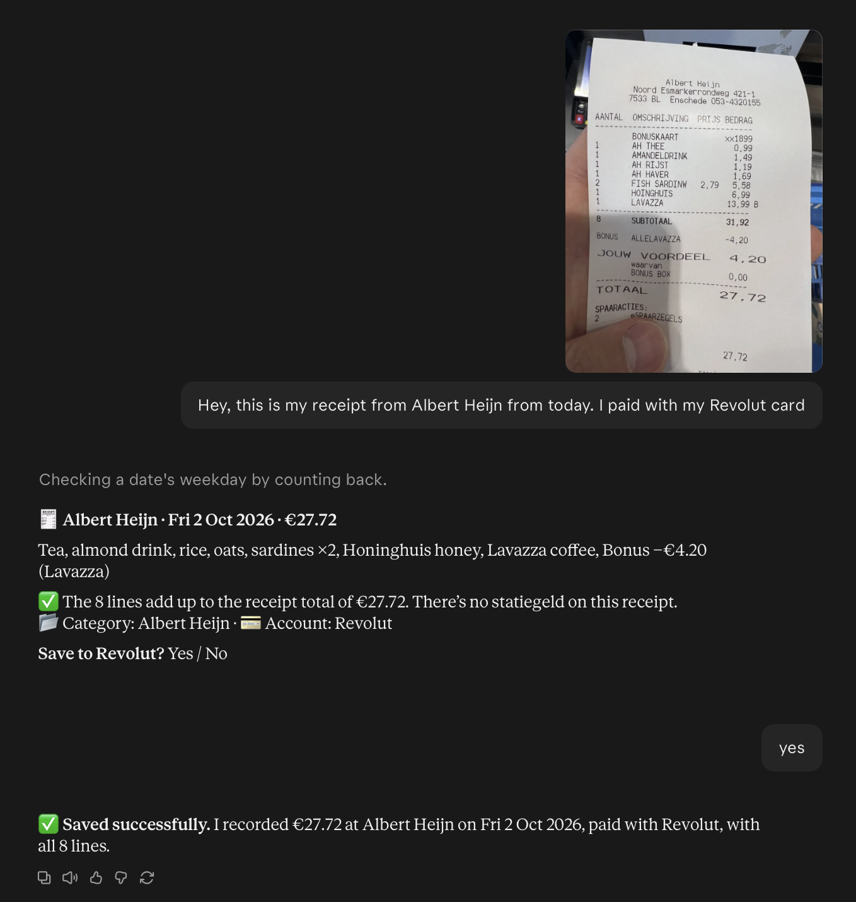
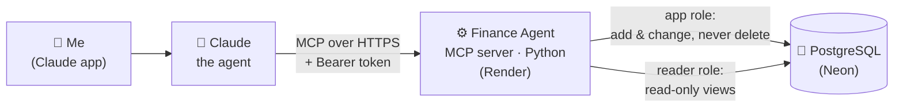
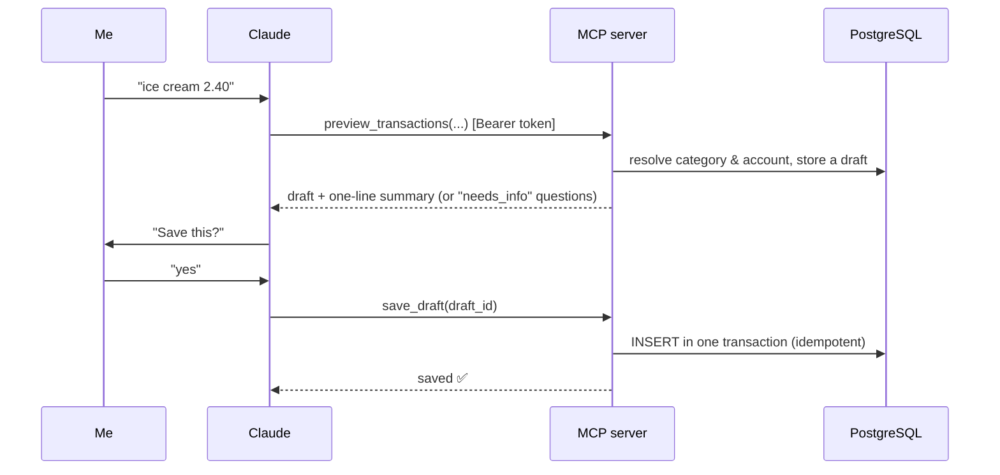

# 💶 Finance Agent

**My personal accountant lives in a chat with Claude.**
I tell it what I bought, in plain words or with a receipt photo. It records the expense in my own cloud database, and it answers any question about my money.


---

## Why I built this

For months I tracked every euro by hand. Every evening I sat down with the day's receipts from Albert Heijn, Jumbo and a coffee bill from DE Café. I typed each one into **Money Flow** (a budgeting app I paid for every year) category, amount, account, note. Then I checked it all against my bank.

It was a daily chore, and it still couldn't tell me things like *which groceries got more expensive since spring, and what that costs me per month*.

I was already talking to Claude every day, so I built **Finance Agent**. Now I send a receipt photo or write *"coffee 3.10 at DE Café"*. Claude records it in my own database and answers any question about my money. Under the hood, it's a remote **MCP server** with a **PostgreSQL** database, running in the cloud.

It started as a private project on my laptop. Now I've reworked it so anyone can use it. I removed my personal files, restructured the code and made the tools general, so they're no longer tied to my own accounts. I put it online because a working system says more than a folder on my laptop, especially while I'm applying for AI engineering roles.

---

## What it looks like

```
Me:      coffee 3.10 and a stroopwafel 1.50 at Den Haag Centraal

Claude:  Here's what I'll save:
           • Expense 3.10 EUR · Cafés  · Spending card · today 08:42 · "coffee"
           • Expense 1.50 EUR · Snacks · Spending card · today 08:42 · "stroopwafel"
         Save both?

Me:      yes

Claude:  Saved ✅ You've spent 46.20 EUR on cafés this month.
```

### From a receipt photo to a record

My old evening routine is now one photo. I snap the Albert Heijn receipt and send it to Claude:
1. **Claude reads every line**, including Bonus discounts and the bottle deposit (*statiegeld*).
2. **The code checks that the lines add up** to the receipt total. If they don't, it says so instead of saving wrong numbers.
3. **I get a preview**, check it, and say *"yes"*.
4. **Every item is stored with its quantity and price per unit.** Later I can ask *"how much has butter gone up since spring?"* or *"what do I usually spend at Jumbo per week?"*

<p align="center">
  
  <br><em>A real receipt: one photo, one sentence, a preview that checks itself, "yes", saved.</em>
</p>

Checking against the bank is now built in too. Once a month I tell Claude the real balance from my banking app. Claude puts it next to the balance the code calculated, so a forgotten payment shows up right away.

### Things you can ask

| You say | What happens |
|---|---|
| *"Where did my money go this month?"* | A money flow per account: income in, transfers between accounts, spending by category, with balances that check themselves |
| *"Will my money last until the end of the month?"* | The code calculates a baseline (average daily spending, days left, expected end balance); Claude adds context like upcoming rent and explains it |
| *"How much did I spend on groceries vs. last month?"* | Claude writes a read-only SQL query; the database runs it under strict locks |
| *"What did I buy yesterday?"* | Searches merchants, notes and receipt items |
| *"It was 2.80, not 2.40"* | Fixes the record; the old value is kept in the history |
| *"Cancel that last coffee"* | Marks it void: it stops counting but is never deleted, and can be restored |
| *"Lent 50 to a friend"* | Recorded as a loan: money leaves the account, but it isn't counted as spending |
| *"How often did I buy something because I was hungry?"* | Reads my notes and tags, and finds patterns |
| *"Monthly review"* | Compares months, points out anything unusual and suggests 1–3 concrete changes |

---

## How it works



Three parts, each with one job:

1. **Claude is the agent.** It understands my words and photos, decides which tool to call, asks me when something is unclear, and explains the results.
2. **The MCP server is the toolbox.** It's a Python service with **15 typed tools** (record, find, fix, void, analyse, forecast…), and it does all the checking and **all the maths**.
3. **PostgreSQL is the memory.** Accounts, categories, transactions, receipt items and a full change history.

### One request, end to end



### The main design rule: code calculates, the model talks

Language models are great at understanding language and bad at reliable arithmetic. So I split the work:

| Claude (the LLM) | The code (Python + SQL) |
|---|---|
| Understands "coffee 3.10 yesterday" and receipt photos | Validates amounts, dates, accounts and categories |
| Picks the right tool and asks follow-up questions | Calculates every sum, balance and forecast baseline |
| Writes SQL for unusual questions | Runs that SQL read-only, with timeouts and row limits |
| Explains, compares and gives advice, labelling its own estimates | Checks its own results (balances are cross-checked two ways) |

Money is stored as `NUMERIC(10,2)`, never as a float.

---

## AI engineering highlights

- **Remote MCP server.** Built with the official `mcp` Python SDK v2 (`MCPServer`) over **Streamable HTTP**, stateless with JSON responses. Claude connects to it as a **custom connector**.
- **Tool design for an agent.** There are 15 tools with typed Pydantic inputs and outputs, descriptions written *for the model*, and **tool annotations** (`read_only_hint`, `destructive_hint`, `idempotent_hint`). Server **instructions** teach Claude the workflow.
- **Human in the loop.** Every write goes *preview → draft → explicit "yes" → save*. Saving is **idempotent**: a retried call never creates a duplicate.
- **No guessing.** When information is missing, the server answers with a `needs_info` list of exact questions, and Claude asks them instead of inventing values. A fuzzy name match (e.g. *"Grocries"*) is never applied silently; it shows up as a warning in the preview.
- **Text-to-SQL with guardrails.** For questions no tool covers, `run_query` lets Claude write SQL. It runs as a **read-only database role** that can see only curated views. On top of that: a READ ONLY transaction, one statement only, a 3-second timeout, and limits of 500 rows / 200 KB. A **schema card** in the tool description tells the model exactly what it can query.
- **Deterministic analytics.** `accounts_overview` (where the money went, ready for a money-flow chart) and `forecast_month` (the baseline facts) are plain, tested code. Claude reasons *on top of* them.
- **Context engineering.** `get_context` gives Claude today's date in my time zone, the accounts with their descriptions, and the categories with aliases, at the start of every chat.

---

## Security

The server holds real financial data, so security was part of the design from day one:

- **Authentication.** Every request needs a **Bearer token** of at least 32 characters, compared in constant time (`hmac.compare_digest`). Without it, the server returns `401`. Two tokens can be active at once, so the token can be swapped without downtime.
- **Least privilege in the database.** Three database **roles**:
  - `owner`, used only from my laptop for migrations;
  - `finance_app`, which can add and change data but has **no DELETE and no DDL**;
  - `finance_reader`, which can only read views.

  Even if the model asked to delete something, the database itself would refuse.
- **Nothing is ever deleted.** Mistakes are *voided* or *fixed*, and every change is written to an add-only `change_log`.
- **Parameterised queries only.** Data never goes into SQL strings.
- **DNS-rebinding protection.** Only requests addressed to the server's own public hostname are accepted.
- **Secrets stay out of the code.** They live in environment variables on Render and in a git-ignored `.env` locally. A **pre-commit privacy guard** blocks commits that look like secrets or real personal data.
- **Private logs.** Logs record the tool name, duration and result code, never the inputs or outputs.

---

## Where it runs

| Part | Technology | Where |
|---|---|---|
| Chat and agent | Claude (custom connector) | Claude app: web, desktop, phone |
| MCP server | Python 3.12, `mcp` SDK v2, Starlette/Uvicorn | **Render** web service (Frankfurt), deployed from this repo with a Blueprint ([`render.yaml`](render.yaml)) |
| Database | PostgreSQL 18 with psycopg 3 | **Neon**, a managed serverless Postgres (Frankfurt), with a separate `dev` branch for practice |
| Tests | pytest, 120 tests | Locally, against the dev database (the tests refuse to run against production) |

A `git push` to `main` → Render rebuilds and redeploys automatically → `/health` says the server is alive.

---

## Inside the repo

```
app/
  server.py          the MCP server: 15 tools, /health, token check
  auth.py            Bearer-token middleware
  db.py              connections per database role, transactions
  models.py          typed inputs and outputs for every tool (Pydantic)
  instructions.py    how Claude should use the tools
  admin.py           migrations, roles, checks, token generation
  services/          the real logic: transactions, resolver, query,
                     overview, forecast, accounts, categories, dates
migrations/          SQL schema: tables, views, constraints
tests/               120 tests: validation, saving, SQL safety, forecast, auth
docs/                a template for Claude Project instructions
examples/            made-up demo data only
render.yaml          one-click deploy to Render
```

**The data model:**
- **Tables:** accounts, categories (two levels, e.g. *Food → Groceries*), transactions (expense, income, refund, transfer, opening balance, revaluation), receipt items, drafts, and a change log.
- **Views:** balances, spending, income, and item prices, built on top of the tables for safe reading.

---

## Run your own copy

Everyone runs their **own** server with their **own** database: no shared server, no shared data.

```bash
uv sync                                                 # install dependencies
uv run pytest                                           # run the tests
uv run python -m app.admin new-token                    # create a secret token in .env
uv run --env-file .env python -m app.admin migrate      # create the tables
uv run --env-file .env python -m app.admin create-roles # create the database roles
uv run --env-file .env python -m app.admin check        # verify the setup
uv run --env-file .env python -m app.server             # start locally on 127.0.0.1:8000
```

Then:
1. Deploy with **Render → New → Blueprint**.
2. In Claude, add a **custom connector** pointing to `https://<your-service>.onrender.com/mcp`, with the header `Authorization: Bearer <token>`.
3. Start a chat with *"set up my accounts"*.

[`docs/claude_project_instructions.md`](docs/claude_project_instructions.md) is a template that turns a Claude Project into your personal accountant.

---

## How I built it

I designed the system and used **Claude Code** as my pair programmer. My role was the architect and orchestrator:
- I set the requirements from my real use;
- I made the design decisions, such as "code calculates, model talks", the three database roles, preview-before-save and void instead of delete;
- I ran an architecture review with several AI reviewer agents and accepted or rejected their findings;
- I reviewed the work through tests.

It was built in small, tested steps. Each commit is one working layer: schema → server skeleton → safe recording → fixes and categories → SQL questions and overview → forecast → deploy.

Some things the tests caught along the way:
- a balance self-check that could never fail, because it compared a number with itself;
- tests that broke only around midnight, because they used the real clock. Now they use a fixed test clock.

## What's next

- CI on GitHub Actions with a throwaway Postgres
- Importing older history from CSV exports

---

Built by **Ammar**. Questions or ideas? Open an issue. I'm happy to talk about MCP, agents and AI engineering.
